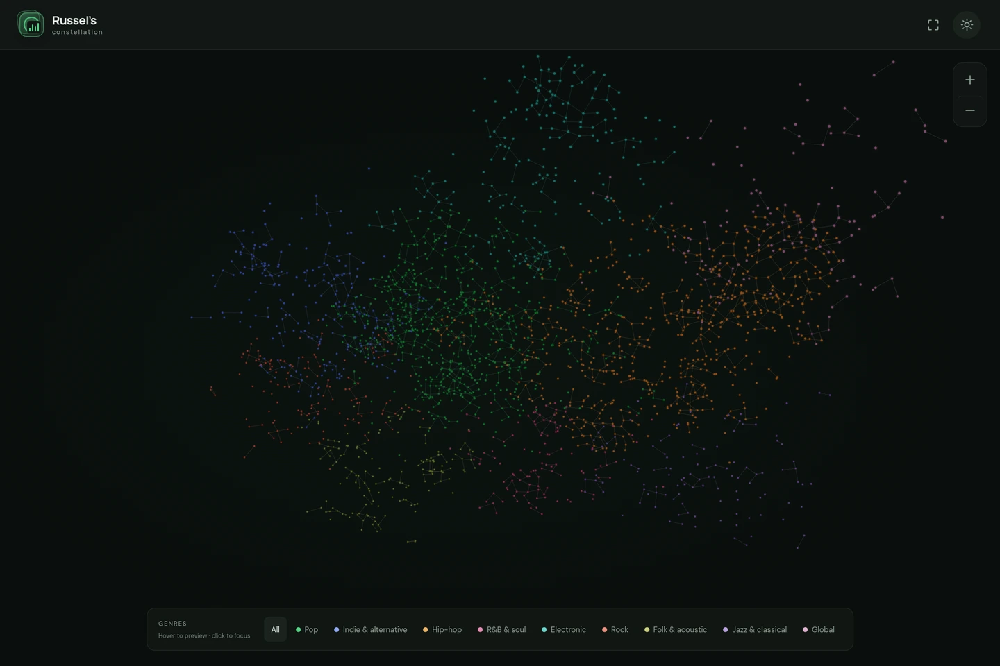

  

<h1 align="center">Russel’s constellation</h1>

My music, mapped in the stars.

  <a href="https://spotify.russel.is-a.dev/"><strong>Explore the constellation ↗</strong></a>
  · <a href="https://spotify.russeldanielpaul.is-a.dev/">Alternate link</a>

A personal music collection you can wander through. Every star is a song, every connection belongs to an artist, and every color leads to a different corner of the collection.

### Read the sky

- **Stars are songs.** Tap or hover to reveal the song and artist.
- **Lines connect an artist’s songs.** Small networks sit together inside overlapping genre regions.
- **Colors follow genres.** Deeper shades reflect more recorded plays, where counts are available.

### Take a look around

Drag to orbit. Pinch or use **+ / −** to move closer. Swipe through genres on your phone, or hover to preview them on desktop. Switch between light and dark, or go fullscreen and let the music fill the view.

Built with Next.js, React and Three.js.

